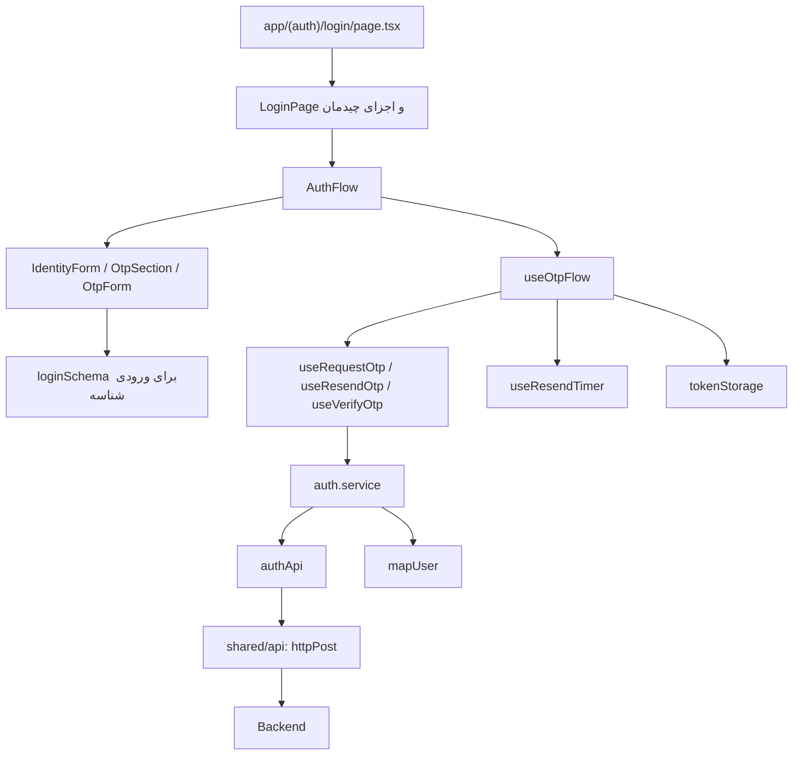

# معماری و فهرست فایل‌های Auth

این فهرست همهٔ فایل‌های پیاده‌سازی و assetهای فیچر در برنچ مبنا را پوشش می‌دهد. مسئولیت یک فایل معیار جداسازی است؛ تعداد خط یا هر جزء کوچک JSX به‌تنهایی دلیل ساخت فایل جدید نیست.

## مسیر وابستگی

فرم از callback ورودی استفاده می‌کند؛ مستقیماً API را صدا نمی‌زند. سرویس React را نمی‌شناسد. مپر فقط داده را تبدیل می‌کند. جزئیات جریان برگشت داده در [flow.md](flow.md) است.

## مسئولیت پوشه‌ها

| پوشه          | مسئولیت                                           | چیزی که نباید به آن منتقل شود                  |
| ------------- | ------------------------------------------------- | ---------------------------------------------- |
| `api/`        | URL، method، payload و تنظیم درخواست              | JSX، state، نمایش پیام و تبدیل DTO به مدل UI   |
| `services/`   | اجرای use case و هماهنگی API و mapper             | React hook، JSX، مدیریت focus                  |
| `mappers/`    | تبدیل صریح DTO به domain                          | HTTP، storage، side effect و قیمت/دادهٔ ساختگی |
| `types/`      | قرارداد ورودی و خروجی و مدل‌های داخلی             | state اجرایی و درخواست شبکه                    |
| `schemas/`    | اعتبارسنجی ورودی در زمان اجرا                     | درخواست شبکه و رندر فرم                        |
| `hooks/`      | چرخهٔ درخواست و state جریان UI                    | کلاس‌های CSS و JSX                             |
| `components/` | نمایش، دریافت ورودی، رویدادهای رابط               | endpoint، ذخیرهٔ مستقیم توکن و مپ DTO          |
| `utils/`      | ابزار دارای مسئولیت مشخص؛ اینجا دسترسی به storage | انبار عمومی منطق نامرتبط یا hook               |
| `assets/`     | فایل‌های تصویری اختصاصی Auth                      | منطق و دادهٔ قراردادی                          |
| `docs/`       | قرارداد، مسیر اجرا، الگو و وضعیت واقعی            | ادعای قابلیت پیاده‌سازی‌نشده                   |

## قراردادها، داده و ابزارها

| فایل                                                          | ورودی ← خروجی و رفتار فعلی                                                                                                                            |
| ------------------------------------------------------------- | ----------------------------------------------------------------------------------------------------------------------------------------------------- |
| [api/auth.api.ts](../api/auth.api.ts)                         | singleton به نام `authApi`؛ سه متد `requestOtp`، `resendOtp` و `verifyOtp`، با `httpPost<T>`                                                          |
| [services/auth.service.ts](../services/auth.service.ts)       | سه تابع هم‌نام؛ دو مورد اول پاسخ را عبور می‌دهند؛ verify، توکن‌ها و `mapUser(response.user)` را برمی‌گرداند                                           |
| [mappers/user.mapper.ts](../mappers/user.mapper.ts)           | `mapUser(dto): User`؛ مپ id، email، mobile، first_name و last_name؛ فیلد اجباری user_type فعلاً جا افتاده است                                         |
| [types/auth.payload.types.ts](../types/auth.payload.types.ts) | DTO درخواست‌ها: `RequestOtpPayload`، `VerifyOtpPayload`، `ResendOtpPayload`                                                                           |
| [types/auth.api.types.ts](../types/auth.api.types.ts)         | `RequestOtpResponse`، `VerifyOtpResponse` و `VerifyOtpResult`؛ آخری خروجی سرویس است، نه DTO خام                                                       |
| [types/auth.types.ts](../types/auth.types.ts)                 | unionهای `AuthStep` و `UserType`؛ به ترتیب مراحل و real/legal                                                                                         |
| [types/user.types.ts](../types/user.types.ts)                 | DTO به نام `UserApiResponse` و مدل مصرفی `User` در یک فایل؛ User هنوز `user_type` به صورت snake_case دارد                                             |
| [schemas/login.schema.ts](../schemas/login.schema.ts)         | `loginSchema` شناسه را trim و موبایل 09 با ۱۱ رقم لاتین یا ایمیل را بررسی می‌کند؛ نوع فرم با `z.infer` ساخته می‌شود                                   |
| [utils/token-storage.ts](../utils/token-storage.ts)           | set/get توکن access و refresh و clearTokens؛ کلیدهای localStorage: `access_token` و `refresh_token`؛ guard مرورگر دارد، خطای storage را catch نمی‌کند |

TypeScript اعتبارسنجی پاسخ شبکه در زمان اجرا نیست. در مسیر فعلی Auth schema برای پاسخ API وجود ندارد.

## هوک‌ها

| فایل                                                        | مسئولیت و API مصرف                                                                                                                                   |
| ----------------------------------------------------------- | ---------------------------------------------------------------------------------------------------------------------------------------------------- |
| [hooks/useRequestOtp.ts](../hooks/useRequestOtp.ts)         | mutation درخواست کد؛ callback اختیاری onSuccess/onError؛ اکنون error را در console هم می‌نویسد                                                       |
| [hooks/useResendOtp.ts](../hooks/useResendOtp.ts)           | mutation ارسال مجدد؛ ورودی token و خروجی RequestOtpResponse                                                                                          |
| [hooks/useVerifyOtp.ts](../hooks/useVerifyOtp.ts)           | mutation تأیید؛ خروجی VerifyOtpResult شامل user مپ‌شده و access/refresh                                                                              |
| [hooks/useOtpResendTimer.ts](../hooks/useOtpResendTimer.ts) | export با نام `useResendTimer`؛ فایل با نام export یکسان نیست. ورودی initialSeconds با پیش‌فرض ۶۰؛ خروجی secondsLeft، isActive، start و reset        |
| [hooks/useOtpFlow.ts](../hooks/useOtpFlow.ts)               | هماهنگی مراحل، سه mutation، تایمر و ذخیرهٔ توکن؛ خروجی step، identifier، user، sendOtp، resend، verify، reset، mockSendOtp و وضعیت‌های loading/timer |

مصرف‌کنندهٔ فعلی `useOtpFlow` فقط `AuthFlow` است. `mockSendOtp` صادر شده ولی مصرف‌کننده‌ای در UI ندارد و mock کامل شبکه نیست.

## کامپوننت‌ها

| فایل                                                                          | مسئولیت و ورودی مهم                                                                                   |
| ----------------------------------------------------------------------------- | ----------------------------------------------------------------------------------------------------- |
| [components/login-page.tsx](../components/login-page.tsx)                     | ترکیب LoginLayout، AuthContent و LoginImageSection؛ نقطهٔ ورود نمای فیچر                              |
| [components/login-layout.tsx](../components/login-layout.tsx)                 | قاب بصری صفحه؛ فقط children                                                                           |
| [components/auth-content.tsx](../components/auth-content.tsx)                 | ترکیب LoginActions و AuthFlow در ستون فرم                                                             |
| [components/auth-flow.tsx](../components/auth-flow.tsx)                       | انتخاب UI بر اساس step؛ اتصال callback فرم‌ها به useOtpFlow؛ در موفقیت فقط متن نمایش می‌دهد           |
| [components/auth-logo.tsx](../components/auth-logo.tsx)                       | رندر logo.png با next/image                                                                           |
| [components/login-header-actions.tsx](../components/login-header-actions.tsx) | export پیش‌فرض LoginActions؛ دکمه‌های زبان و تم فعلاً handler ندارند                                  |
| [components/login-image-section.tsx](../components/login-image-section.tsx)   | رندر login-cover.png و چیدمان تصویر                                                                   |
| [components/identity-form.tsx](../components/identity-form.tsx)               | state انتخاب real/legal، فرم RHF، resolver؛ callback `onSuccess(identifier, userType)` و prop loading |
| [components/user-type-selector.tsx](../components/user-type-selector.tsx)     | کنترل انتخاب نوع کاربر با value و onChange؛ هیچ درخواستی ندارد                                        |
| [components/login-form-header.tsx](../components/login-form-header.tsx)       | عنوان، input شناسه و توضیح/خطای اعتبارسنجی؛ value، error و register می‌گیرد                           |
| [components/otp-section.tsx](../components/otp-section.tsx)                   | توضیح مقصد ارسال و ترکیب OtpForm؛ props درخواست/تایمر را عبور می‌دهد                                  |
| [components/otp-form.tsx](../components/otp-form.tsx)                         | state کد، بررسی طول ۶، دکمه تأیید و ارسال مجدد؛ error داخلی فعلاً در JSX نمایش داده نمی‌شود           |
| [components/otp-input.tsx](../components/otp-input.tsx)                       | ورودی کنترل‌شدهٔ شش‌خانه‌ای، focus، paste، Backspace و کلیدهای جهت؛ value و onChange می‌گیرد          |

`onSuccess` در IdentityForm به معنی معتبر شدن فرم و تحویل ورودی است، نه موفقیت درخواست بک. برای فرم‌های جدید نام `onSubmit` این تفاوت را واضح‌تر می‌کند؛ نام فعلی در کد تغییر نکرده است.

`"use client"` مرز ورود به گراف کلاینت است؛ فایل‌های زیر این مرز نیز در کلاینت مصرف می‌شوند. برای هر کامپوننت نمایشی directive اضافه نکنید؛ برای entry قابل مصرفی که hook یا event دارد، مرز را آگاهانه تعیین کنید.

## Assetها

| فایل                     | مصرف فعلی                |
| ------------------------ | ------------------------ |
| `assets/logo.png`        | AuthLogo                 |
| `assets/login-cover.png` | LoginImageSection        |
| `assets/arrow-down.svg`  | LoginActions             |
| `assets/global.svg`      | LoginActions             |
| `assets/moon.svg`        | LoginActions             |
| `assets/key.png`         | در کد src مصرفی پیدا نشد |

## وابستگی بیرون فیچر و استفادهٔ مجدد

| مسیر                                                                              | نحوهٔ استفاده                                                                                           |
| --------------------------------------------------------------------------------- | ------------------------------------------------------------------------------------------------------- |
| [shared/api/index.ts](../../../shared/api/index.ts)                               | ورودی پیشنهادی HTTP: `import { httpGet, httpPost } from "@/shared/api"`                                 |
| [shared/api/client.ts](../../../shared/api/client.ts)                             | تنظیم مشترک Axios، timeout ده ثانیه، baseURL و withCredentials؛ کلاینت جدا در هر فیچر نسازید            |
| [shared/api/interceptors.ts](../../../shared/api/interceptors.ts)                 | اکنون فقط passthrough و reject خطا؛ فراخوانی setupInterceptors در src پیدا نشد؛ refresh یا Bearer ندارد |
| [providers/react-query-provider.tsx](../../../providers/react-query-provider.tsx) | تأمین QueryClient؛ پیش از استفاده از hookهای درخواست، وجود provider در layout را بررسی کنید             |
| [components/ui/button.tsx](../../../components/ui/button.tsx)                     | Button با variantهای primary، secondary، ghost و پشتیبانی asChild                                       |
| [components/ui/input.tsx](../../../components/ui/input.tsx)                       | Input مشترک برای فرم‌های جدید؛ ورودی فعلی OTP رفتار اختصاصی دارد                                        |
| [lib/utils.ts](../../../lib/utils.ts)                                             | `cn` برای ترکیب className                                                                               |
| [store/authStore.ts](../../../store/authStore.ts)                                 | store قدیمی با مدل و کلید ذخیره‌سازی متفاوت؛ به این flow متصل نیست، مرجع user فعلی فرض نشود             |
| [lib/api.ts](../../../lib/api.ts)                                                 | در این برنچ کامنت شده؛ جایگزین قابل مصرف برای shared/api نیست                                           |
| [shared/api/apiClient.ts](../../../shared/api/apiClient.ts)                       | wrapper مستقل fetch در سایر فیچرها؛ مسیر HTTP Auth از آن عبور نمی‌کند                                   |

Auth فعلاً `index.ts` عمومی ندارد. مصرف صفحه اکنون import مستقیم LoginPage است. برای توسعهٔ آینده، export محدود صفحه و typeهای واقعاً عمومی پیشنهاد می‌شود؛ این exportها هنوز ایجاد نشده‌اند. tokenStorage و state مراحل Auth را به‌عنوان ابزار عمومی سایر فیچرها کپی نکنید.

## اتصال تمدید خودکار

- api/token.api.ts: POST تمدید با Axios خام، خارج از interceptor کلاینت اصلی برای جلوگیری از حلقه.
- services/token.service.ts: اعتبارسنجی پاسخ و به‌روزرسانی توکن تنها برای همان نشست؛ پاک‌سازی روی رد قطعی اعتبار.
- shared/api/interceptors.ts: Bearer، اشتراک عملیات refresh و یک تکرار محدود درخواست اصلی.
- utils/token-storage.ts: ذخیرهٔ توکن‌ها و auth_session_id غیرمحرمانه؛ شناسهٔ نشست با ورود جدید عوض می‌شود و هنگام refresh ثابت است تا idempotency سفارش تغییر نکند.
- hooks/use-access-token.ts: اشتراک تغییرات storage برای وضعیت UI؛ اثبات معتبر بودن نشست نیست.

تست‌های یکپارچگی آفلاین در cart/tests/cart-api.test.cjs جریان تمدید همراه درخواست سبد را پوشش می‌دهند. همهٔ درخواست‌ها در تست با adapter جایگزین می‌شوند.
