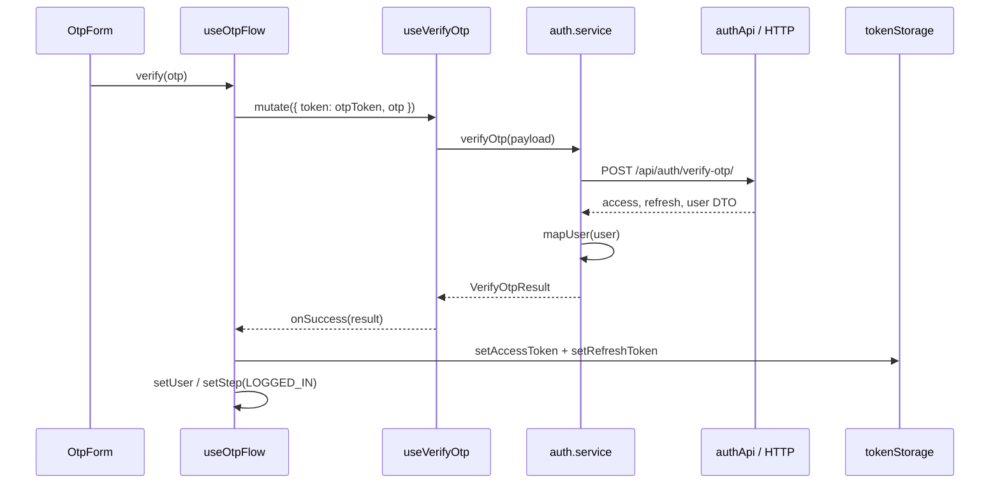

# جریان اجرای Auth

این سند رفتار فعلی است. اصلاح‌های پیشنهادی در [review.md](review.md) جدا شده‌اند.

## مالکیت state

| داده | محل نگهداری | طول عمر |
| --- | --- | --- |
| مقدار خام identifier و خطای فرم | React Hook Form در IdentityForm | تا unmount فرم |
| نوع کاربر real/legal | state در IdentityForm، پیش‌فرض real | تا unmount فرم |
| step، identifier ارسال‌شده، otpToken، user | useOtpFlow | عمر mount شدن AuthFlow |
| متن کد OTP | OtpForm | عمر فرم کد |
| pending و نتیجهٔ درخواست | سه mutation hook | چرخهٔ درخواست/مصرف mutation |
| secondsLeft | useResendTimer | عمر هوک |
| access و refresh | tokenStorage → localStorage | فراتر از reload تا حذف یا تغییر storage |

در زمان ورود مجدد به صفحه، useOtpFlow از storage یا API کاربر را بازیابی نمی‌کند؛ همیشه با ENTER_IDENTIFIER شروع می‌شود.

## ورود شناسه و ارسال کد

1. route صفحه، LoginPage و سپس AuthFlow را رندر می‌کند.
2. AuthFlow یک بار useOtpFlow را فراخوانی می‌کند؛ مرحلهٔ اول ENTER_IDENTIFIER است.
3. IdentityForm با loginSchema ورودی را trim و validate می‌کند. موبایل باید با 09 شروع شود و ۱۱ رقم لاتین داشته باشد؛ ایمیل با Zod بررسی می‌شود. رقم فارسی/عربی normalize نمی‌شود.
4. callback فرم، `sendOtp(identifier, userType)` را صدا می‌زند.
5. useOtpFlow شناسه را در state قرار می‌دهد و payload `{ id, user_type }` را به useRequestOtp می‌دهد.
6. هوک → سرویس → authApi → httpPost → `POST /api/auth/request-otp/`.
7. در موفقیت، token موقت در state ذخیره و مرحله OTP_SENT می‌شود؛ callback موفق mutate تایمر را با ۶۰ ثانیه آغاز می‌کند.
8. در خطا، مرحله تغییر نمی‌کند. اکنون useOtpFlow خطای mutation را به UI برنمی‌گرداند.

نقص فعلی: IdentityForm prop به نام loading دارد، اما AuthFlow مقدار isSending را به آن نمی‌دهد؛ بنابراین دکمهٔ ارسال اولیه در مسیر فعلی از pending درخواست آگاه نیست.

## تأیید OTP

OtpForm فقط طول ۶ رقم را بررسی می‌کند و هنگام verify pending دکمه را غیرفعال می‌کند. OtpInput ارقام غیرلاتین را با regex فعلی حذف می‌کند؛ paste فقط شش رقم اول لاتین را نگه می‌دارد.

پس از موفقیت، AuthFlow متن `Login Success` نشان می‌دهد. redirect، بازیابی پروفایل، ادغام سبد یا اتصال به store سراسری در این برنچ وجود ندارد. اگر یکی از عملیات localStorage خطا بدهد، fallback فعلی وجود ندارد و اجرای ادامهٔ callback تضمین نشده است.

## ارسال مجدد

1. OtpForm دکمهٔ ارسال مجدد را تا پایان تایمر یا در زمان isResending غیرفعال می‌کند.
2. `resend()` در useOtpFlow نبود otpToken یا secondsLeft بزرگ‌تر از صفر را بررسی می‌کند.
3. `{ token: otpToken }` به `POST /api/auth/resend-otp/` می‌رود.
4. در موفقیت، token موقت با پاسخ جدید جایگزین و تایمر دوباره ۶۰ ثانیه می‌شود.
5. در خطا، موفقیت یا شروع مجدد تایمر رخ نمی‌دهد؛ پیام خطای بک در UI فعلی نمایش داده نمی‌شود.

`resend_after_seconds` در type پاسخ وجود دارد، اما هیچ‌کدام از دو مسیر ارسال آن را مصرف نمی‌کنند. تایمر فعلی شمارندهٔ رابط است؛ جای محدودیت ارسال مجدد در بک را نمی‌گیرد. verify و resend در سطح flow نسبت به یکدیگر قفل نشده‌اند.

## reset و موک

- `reset()`: مرحله، otpToken، identifier و تایمر را بازنشانی می‌کند؛ user، access/refresh و state mutationها را پاک نمی‌کند. logout نیست و در UI فعلی دکمه‌ای برای آن نیست.
- `mockSendOtp(loginId)`: شناسه، متن `mock-token` و مرحله OTP_SENT را تنظیم می‌کند؛ تایمر را شروع نمی‌کند. در UI مصرفی ندارد.
- اگر mockSendOtp دستی فراخوانی شود، resend و verify همچنان مسیر API واقعی دارند. آن را جریان موک کامل یا fallback خطای بک معرفی نکنید.
